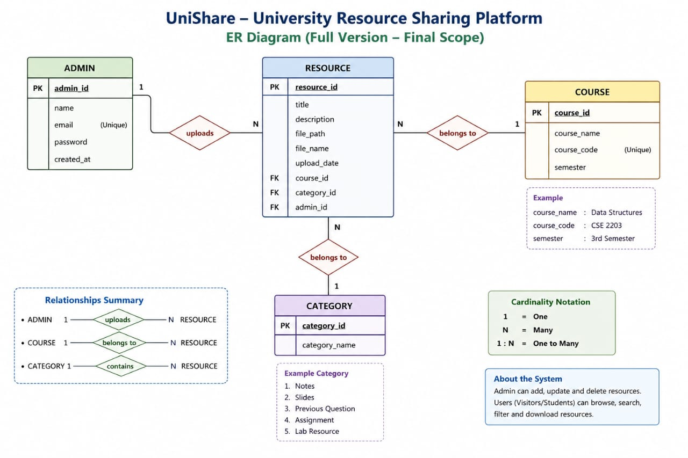

# UniShare – University Resource Sharing Platform

[](https://fastapi.tiangolo.com)
[](https://www.python.org/)
[](https://www.sqlalchemy.org/)
[](https://tailwindcss.com/)
[]()

**UniShare** is an academic resource-sharing platform engineered according to the official Entity-Relationship (ER) specification. It enables university students to discover, search, filter, and download course documents (lecture notes, slide decks, midterm/final questions, assignments, and lab manuals), while providing authorized administrators with a dashboard to curate academic materials.

---

## 🏛️ System Architecture & ER Specification

The relational architecture models four core entities with strict referential integrity:



### Entity-Relationship Mapping

| Entity | Primary Key | Key Attributes | Relationships |
| :--- | :--- | :--- | :--- |
| **`ADMIN`** | `admin_id` | `name`, `email` *(Unique)*, `password` *(Bcrypt)*, `created_at` | `1` Admin uploads `N` Resources |
| **`COURSE`** | `course_id` | `course_name`, `course_code` *(Unique)*, `semester` | `1` Course has `N` Resources |
| **`CATEGORY`** | `category_id` | `category_name` *(Unique)* (Notes, Slides, etc.) | `1` Category contains `N` Resources |
| **`RESOURCE`** | `resource_id` | `title`, `description`, `file_path`, `file_name`, `upload_date`, `course_id` *(FK)*, `category_id` *(FK)*, `admin_id` *(FK)* | Belongs to Course, Category & Admin |

### Cardinality Summary
- **Admin uploads Resources**: `1 : N` (One admin uploads many resources)
- **Course belongs to Resources**: `1 : N` (One course contains many resources)
- **Category contains Resources**: `1 : N` (One category classifies many resources)

---

## ✨ Features

### 🎓 For Students & Visitors (Public Access)
- **Browse Resources**: View all uploaded academic resources with courses, categories, semesters, and upload metadata.
- **Instant Search**: Real-time keyword search across resource titles, descriptions, course codes, and course names.
- **Multi-Facet Filtering**: Filter dynamically by category (Notes, Slides, Previous Questions, Assignments, Lab Resources) and course.
- **Resource Details**: Detailed preview card with full syllabus description, uploader information, file type, and exact file size.
- **Direct File Downloads**: Secure download endpoint serving PDFs, documents, slide decks, and code archives.

### 🛡️ For Administrators (Authenticated Access)
- **Secure Authentication**: JWT token-based authentication with bcrypt password hashing.
- **Resource Management**:
  - Upload new resources with multi-part file uploads and metadata.
  - Update resource descriptions, titles, course associations, and replace uploaded files.
  - Delete resources with automatic physical file cleanup.
- **Course Management**: Add and manage university courses (`course_name`, `course_code`, `semester`).
- **Category Management**: Add and maintain academic resource categories.

---

## 🛠️ Tech Stack

- **Backend Framework**: [FastAPI](https://fastapi.tiangolo.com/) (Asynchronous Python Web Framework)
- **ORM & Database**: [SQLAlchemy 2.0](https://www.sqlalchemy.org/) with SQLite (local development) / PostgreSQL support
- **Data Validation**: [Pydantic V2](https://docs.pydantic.dev/)
- **Security**: OAuth2 with JWT tokens ([python-jose](https://github.com/mpdavis/python-jose)) & [bcrypt](https://pypi.org/project/bcrypt/)
- **Frontend**: Responsive Single-Page Application (SPA) built with Tailwind CSS, FontAwesome 6, and Vanilla JavaScript
- **Testing**: [Pytest](https://docs.pytest.org/) & [HTTPX](https://www.python-httpx.org/) (19 integration tests)

---

## 🚀 Getting Started

### 1. Prerequisites
- Python 3.10+ (or Conda environment)
- `pip` package manager

### 2. Installation

Clone the repository and install dependencies:
```bash
git clone https://github.com/naimNB/UniShare.git
cd UniShare

# Install dependencies
pip install -r requirements.txt
```

### 3. Run the Application

Start the development server using the startup script:
```bash
./run.sh
```

Or manually using Uvicorn:
```bash
uvicorn main:app --host 127.0.0.1 --port 8000 --reload
```

Open your browser at:
- **Web App**: [http://127.0.0.1:8000](http://127.0.0.1:8000)
- **Interactive API Documentation (Swagger UI)**: [http://127.0.0.1:8000/docs](http://127.0.0.1:8000/docs)
- **Alternative API Docs (ReDoc)**: [http://127.0.0.1:8000/redoc](http://127.0.0.1:8000/redoc)

---

## 🔑 Default Credentials

The database automatically initializes and pre-seeds default courses, categories, and an administrator account on first run:

| Role | Email | Password |
| :--- | :--- | :--- |
| **System Admin** | `admin@unishare.com` | `admin123` |

---

## 📡 REST API Reference

### 🔐 Authentication (`/api/auth`)
| Method | Endpoint | Description | Auth Required |
| :--- | :--- | :--- | :--- |
| `POST` | `/api/auth/login` | Authenticate Admin and receive JWT token | No |
| `POST` | `/api/auth/register` | Register a new administrator account | No |
| `GET` | `/api/auth/me` | Fetch currently logged-in Admin profile | Yes (Bearer) |

### 📚 Academic Resources (`/api/resources`)
| Method | Endpoint | Description | Auth Required |
| :--- | :--- | :--- | :--- |
| `GET` | `/api/resources` | List, search, and filter academic resources | No |
| `GET` | `/api/resources/{id}` | Retrieve details of a specific resource | No |
| `GET` | `/api/resources/{id}/download`| Download the uploaded resource file | No |
| `POST` | `/api/resources` | Upload a new resource file and metadata | Yes (Bearer) |
| `PUT` | `/api/resources/{id}` | Update resource details / replace file | Yes (Bearer) |
| `DELETE`| `/api/resources/{id}` | Delete a resource and its storage file | Yes (Bearer) |

### 📖 Courses (`/api/courses`)
| Method | Endpoint | Description | Auth Required |
| :--- | :--- | :--- | :--- |
| `GET` | `/api/courses` | List all university courses with resource counts | No |
| `GET` | `/api/courses/{id}` | Retrieve single course information | No |
| `POST` | `/api/courses` | Add a new course | Yes (Bearer) |
| `PUT` | `/api/courses/{id}` | Update existing course details | Yes (Bearer) |
| `DELETE`| `/api/courses/{id}` | Delete a course | Yes (Bearer) |

### 🏷️ Categories (`/api/categories`)
| Method | Endpoint | Description | Auth Required |
| :--- | :--- | :--- | :--- |
| `GET` | `/api/categories` | List all academic categories with resource counts | No |
| `GET` | `/api/categories/{id}` | Retrieve single category information | No |
| `POST` | `/api/categories` | Add a new category | Yes (Bearer) |
| `PUT` | `/api/categories/{id}` | Update existing category | Yes (Bearer) |
| `DELETE`| `/api/categories/{id}` | Delete a category | Yes (Bearer) |

---

## 🧪 Running Automated Tests

Run the complete test suite with pytest:
```bash
pytest tests/ -v
```

All 19 tests verify database models, foreign key relationships, JWT authentication, search filters, file uploads, and downloads.

---

## 📂 Project Structure

```
UniShare/
├── app/
│   ├── __init__.py
│   ├── config.py             # Environment settings & JWT configuration
│   ├── database.py           # SQLAlchemy engine & session dependency
│   ├── models/               # SQLAlchemy ORM Models (matching ER diagram)
│   │   ├── admin.py
│   │   ├── course.py
│   │   ├── category.py
│   │   └── resource.py
│   ├── schemas/              # Pydantic v2 schemas for request/response validation
│   │   ├── admin.py
│   │   ├── course.py
│   │   ├── category.py
│   │   └── resource.py
│   ├── services/
│   │   ├── auth.py           # Bcrypt password hashing & JWT token verification
│   │   └── seeder.py         # Initial database seeder for admin, courses & categories
│   └── routers/              # FastAPI API Routers
│       ├── auth.py
│       ├── courses.py
│       ├── categories.py
│       └── resources.py
├── docs/
│   └── er_diagram.jpeg       # Official ER Diagram specification
├── static/
│   └── index.html            # Complete responsive Tailwind CSS web application
├── tests/                    # Integration test suite
│   ├── conftest.py
│   ├── test_auth.py
│   ├── test_courses_categories.py
│   └── test_resources.py
├── uploads/                  # Secure file storage directory for resource documents
├── main.py                   # FastAPI application entrypoint & static mounting
├── requirements.txt          # Python dependencies
├── run.sh                    # Single-command startup script
└── README.md                 # Project documentation
```

---

## 📄 License

This project is developed for educational and academic resource sharing.
