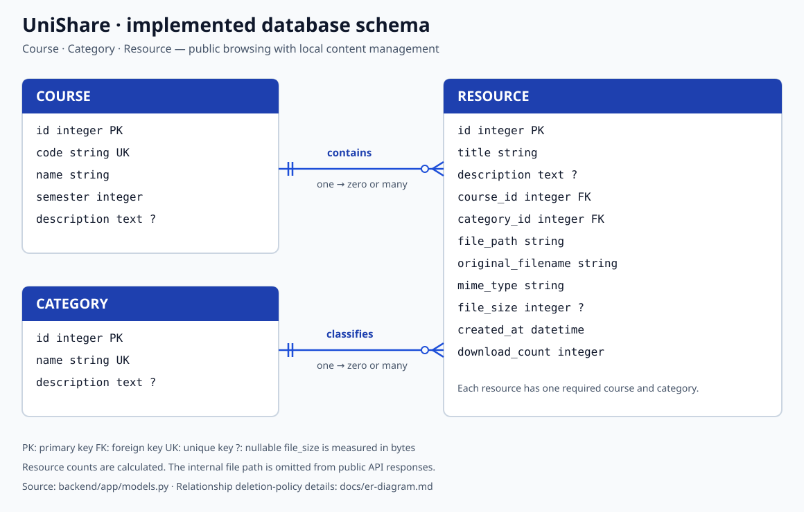

# UniShare — University Resource Sharing Platform

UniShare is a university Web Engineering project for finding and downloading academic resources. Visitors can browse without an account. Content is managed by a developer using a local command-line tool; there is no login, registration, administrator dashboard, or public content-editing API.

## Features and architecture

- Semester-wise course browsing and course details.
- Resource search by title, description, course code, or course name; combined course, semester, and category filters.
- Paginated resource listings, resource details, inline PDF preview, and downloads.
- Responsive React interface with loading, empty, error, and not-found states.
- Local SQLite metadata and document storage; developer-only seed/import commands.

| Layer | Implementation |
| --- | --- |
| Frontend | React 19, TypeScript, Vite, Tailwind CSS v4, React Router, Lucide React |
| Backend | FastAPI, SQLAlchemy 2.x, Pydantic v2 |
| Data | SQLite with foreign keys enabled; files stored outside the frontend bundle |
| Checks | Pytest, Node test runner, Oxlint, TypeScript, Vite production build |

The frontend requests JSON from `/api`. During development, Vite proxies those requests to FastAPI at `http://127.0.0.1:8000`. FastAPI serves API responses and documents; it does not serve the React application.

```text
UniShare/
├── backend/
│   ├── app/                  # Configuration, database, models, schemas, routers
│   ├── scripts/seed.py       # Local demo seeding and document imports
│   ├── tests/                # Backend regression and API tests
│   ├── storage/uploads/      # Local documents (ignored except .gitkeep)
│   └── requirements.txt
├── frontend/
│   ├── src/                  # Pages, components, API client, shared types
│   ├── package.json
│   └── package-lock.json
└── docs/                     # Current schema diagram and retained legacy image
```

## Database design



Every resource belongs to one course and one category. Course codes and category names are unique. Resource metadata includes the original filename, internal storage path, MIME type, size, creation time, and a download-request counter. Public resource responses omit the internal file path.

See [the diagram source and schema notes](docs/er-diagram.md). The earlier `docs/er_diagram.jpeg` is preserved as a legacy design artifact; it does not describe the implemented schema.

## Local setup

Run backend commands from the **repository root**, using a Python environment dedicated to this checkout.

Prerequisites:

- Python 3.12 with `venv` and `pip` available. The clean-install verification used Python 3.12.16.
- Node.js 24 and npm. The clean-install verification used Node.js 24.21.0.
- Git and two terminal windows.

```bash
git clone https://github.com/naimNB/UniShare.git
cd UniShare
python3.12 -m venv .venv
source .venv/bin/activate
python -m pip install -r backend/requirements.txt
```

If your Python installation lacks `ensurepip`, install your distribution's Python venv/pip support, or use an already available `uv` installation:

```bash
uv venv --python 3.12 .venv
uv pip install --python .venv/bin/python -r backend/requirements.txt
source .venv/bin/activate
```

On Windows, activate with `.venv\Scripts\Activate.ps1` in PowerShell instead. The remaining Python commands are the same.

### Seed a fresh demonstration database

```bash
python -m backend.scripts.seed seed
```

A fresh database receives all 78 official CSE curriculum courses across 8 semesters (161.00 total credits), 5 categories, and 12 demonstration resources with generated sample PDFs. These are **demonstration documents**, and their initial download counts are sample values. They are not verified official university materials.

Seeding is explicit: starting the API creates missing tables but does not add demo content. Repeating the seed does not duplicate the demo records, but it regenerates demo files and updates matching demo-resource metadata. Use it on a disposable demo database, not as an update tool for a curated library. Do not use `--reset` on data you want to keep; it drops database tables.

### Start the backend — terminal 1

```bash
source .venv/bin/activate
python -m uvicorn backend.app.main:app --host 127.0.0.1 --port 8000 --reload
```

- API health: <http://127.0.0.1:8000/api/health>
- Interactive API documentation: <http://127.0.0.1:8000/docs>

### Start the frontend — terminal 2

From the repository root:

```bash
cd frontend
npm ci
npm run dev -- --host 127.0.0.1
```

Open <http://127.0.0.1:5173>. Keep both servers running. `npm ci` uses the committed lockfile; do not apply forceful dependency audit fixes without reviewing compatibility.

## Configuration and data safety

| Setting | Default | Use |
| --- | --- | --- |
| `DATABASE_PATH` | `backend/unishare.db` | SQLite file path; use an absolute path when overriding |
| `DATABASE_URL` | SQLite URL built from `DATABASE_PATH` | Overrides `DATABASE_PATH` if set; SQLite is the tested database |
| `STORAGE_DIR` | `backend/storage/uploads` | Document directory; use an absolute path when overriding |
| `VITE_API_BASE_URL` | Empty | Optional API origin, e.g. `http://127.0.0.1:8000`; do not append `/api` |

Set backend environment variables **before** running the CLI or API. The backend reads process environment variables; it does not load a `.env` file automatically. Vite can read `VITE_API_BASE_URL` from `frontend/.env.local`; restart Vite after changing it. Frontend environment values are public and must not contain secrets.

For a separate demo library, set `DATABASE_PATH` and `STORAGE_DIR` to new locations in every backend/CLI terminal, and ensure `DATABASE_URL` is not overriding them. Back up the database and storage directory together before modifying an existing library. Neither is committed to Git.

The project is configured for local development. Its CORS allowlist contains localhost/127.0.0.1 on ports 5173 and 3000. A deployed frontend needs SPA route fallback to `index.html` and either a same-origin `/api` reverse proxy or an explicitly configured API origin/CORS policy. The Vite development proxy is not part of the production bundle. `npm run preview` is a local build check, not a production server.

## Developer-only document imports

The course and category must already exist. Example, from the repository root with the backend environment activated:

```bash
python -m backend.scripts.seed import-file \
  --file "/absolute/path/Normalization.pdf" \
  --course "CSE 2103" \
  --category "Lecture Notes" \
  --title "Normalization study notes" \
  --description "Notes on functional dependencies and normal forms."
```

The importer preserves the source basename in metadata while using a collision-resistant storage name. Re-importing the same trimmed title into the same course updates that resource, including its category and file; a different title or course creates a separate record. The new file is validated before the database commit. On validation or database failure before a successful commit, the new file is removed and the previous resource remains intact. A process interruption can leave an unreferenced file; the filesystem and database do not share a transaction. A post-commit refresh failure is reported without deleting the committed file. After a successful replacement, the old file is removed only if it is safely inside storage and no resource still references it. Run imports sequentially: this local tool is not a concurrent upload service.

Allowed extensions are `.pdf`, `.txt`, `.docx`, `.zip`, and `.md`, with a 50 MiB maximum. PDF imports undergo structural validation with pypdf; malformed, encrypted, and zero-page PDFs are rejected. Other formats are checked for extension and size. PDF validation is not malware scanning. Import only material you trust and have permission to share. The PDF viewer is intended for PDFs; browser handling of other formats varies.

There is no general-purpose course/category editor or resource-deletion CLI. Do not remove stored files manually while resource records still reference them.

## Public API

All content endpoints below use `GET` and require no credentials. There are no public upload, update, or delete endpoints. Downloads increment a metadata counter, so “read-only” describes content management, not every database operation.

| Endpoint | Purpose |
| --- | --- |
| `/api/health` | API process status |
| `/api/courses` | Courses and resource counts; optional `semester` |
| `/api/courses/{id}` | Course details and associated resources |
| `/api/categories` | Categories and resource counts |
| `/api/resources` | Search/filter/paginate resources |
| `/api/resources/{id}` | Resource details |
| `/api/resources/{id}/preview` | Inline document response |
| `/api/resources/{id}/download` | Attachment response; counts download initiation |

Resource-list parameters: `q` (up to 200 characters), `semester` (1–12), `course_id` and `category_id` (positive integers), `limit` (1–100; default 20), and `offset` (nonnegative integer; default 0). Filters combine. Search matches resource titles/descriptions and course codes/names. Results are ordered by creation time descending, then ID descending, and returned as `{ items, total, limit, offset }`.

The sample courses cover semesters 1–8. A missing resource/course returns 404; invalid API query parameters return 422. The download count records initiated responses, not unique users or completed downloads.

## Verification

From the repository root with the backend environment activated:

```bash
python -m pytest backend/tests -q
```

From `frontend/`:

```bash
npm test
npm run lint
npx tsc -b
npm run build
```

`npm test` runs dependency-free regression tests for query validation, error formatting, shortcuts, and request cancellation using Node 24. These are utility tests, not a full browser automation suite. `npm run build` also runs the TypeScript build check. Generated assets are written to `frontend/dist`. See [frontend notes](frontend/README.md) for frontend-specific checks. Avoid treating a successful build as proof of browser behavior.

Before the demonstration, rehearse course navigation, combined filters, a query using a course code, resource details, a Bengali-named PDF preview/download, empty results, and an API outage. Check phone-width and keyboard navigation in the actual presentation browser. With only 12 seed resources, import an additional trusted sample if demonstrating multi-page navigation.

## Team contributions

Small follow-up contributions can include keyboard/accessibility checks, permitted academic sample documents with attribution, additional filter/count tests, a clean-machine setup walkthrough, and the project report/demo script. Each contribution should have a focused pull request and a teammate who can explain and demonstrate it.
