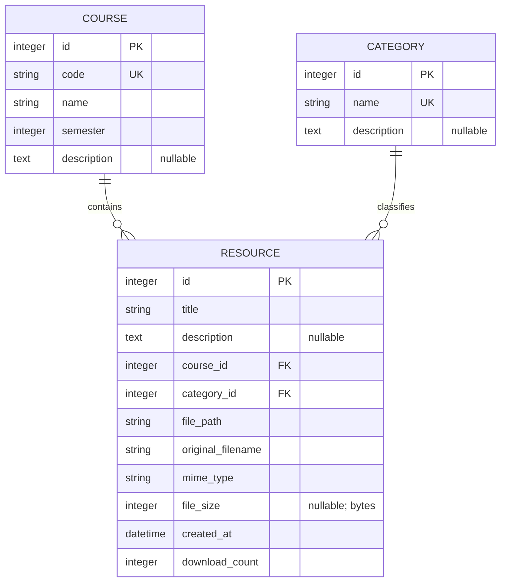

# Implemented database schema

This diagram represents `backend/app/models.py`: three tables, no accounts or administrator table. The current visual is [er-diagram.svg](er-diagram.svg). The original [er_diagram.jpeg](er_diagram.jpeg) remains unchanged as a **legacy design artifact**, not the current implementation.

- Every resource requires one course and one category; either parent may have zero or more resources.
- `Course.code` and `Category.name` are unique. IDs are integer primary keys.
- `Resource.file_path` is internal storage metadata; API resource schemas do not expose it. `original_filename` is used for preview/download filenames.
- SQLite foreign keys are enabled on database connections. The course foreign key declares `ON DELETE CASCADE`; the category foreign key declares `ON DELETE RESTRICT`.
- Both ORM relationships currently configure `delete-orphan` cascades. Consequently, deleting a category through the ORM can remove its resources before the database restriction applies. There is no public delete route. Changing this behavior is a separate remaining data-management improvement.
- Resource counts are calculated from related records rather than stored on Course or Category. Download counts represent initiated download responses.
- `(course_id, title)` identifies re-imports in the local CLI; it is not a database uniqueness constraint. Run imports sequentially.

Keep the Mermaid source, SVG, and model changes consistent when evolving the schema.
